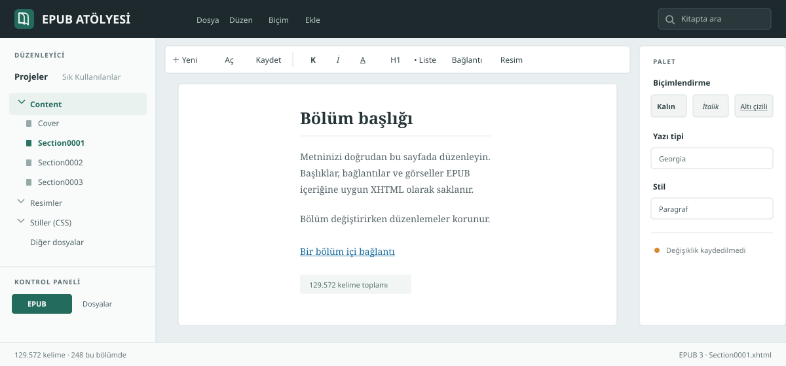

# EPUB Atölyesi

EPUB 2 ve EPUB 3 kitaplarını açıp bölüm içeriklerini düzenlemek için geliştirilen Windows masaüstü editörü ve etkileşimli web prototipi.



Masaüstü sürümü C#/.NET 8 WPF, MVVM ve WebView2 tabanlı `contentEditable` düzenleyici kullanır. EPUB içindeki XHTML bölümleri doğrudan düzenlenir; amaç yalnızca kitap metadata'sını değil, kitap metnini de düzenlemektir.

## Proje Yapısı

```text
desktop/             Windows WPF uygulaması
  Core/              EPUB paketini açma, düzenleme ve kaydetme
  Editor/            WebView2 WYSIWYG belge yüzeyi
  Infrastructure/    Ayarlar ve AppData günlükleri
  Localization/      Türkçe ve İngilizce .resx kaynakları
  ViewModels/        CommunityToolkit.Mvvm uygulama durumu
desktop.Tests/       EPUB2/EPUB3 paket testleri
src/                 Vite tabanlı prototip ve C# örnek proje gezgini
assets/              Proje görselleri
```

## Masaüstü Uygulaması

Windows 10/11 x64 için [kurulumlu Windows paketi](https://github.com/nthreext-bit/e-book-atolyesi/releases/latest) önerilir. Uygulama .NET 8 çalışma zamanını kendi içinde taşır; son kullanıcıya ayrıca .NET kurmak gerekmez. Kurulum, WebView2 Runtime yoksa Microsoft yükleyicisini çalıştırır. Runtime yine de bulunamazsa uygulama ekranda uyarı ve indirme bağlantısı gösterir.

Kaynak koddan derleme ve `dotnet run` için .NET 8 SDK gerekir. Web prototipi için ayrıca Node.js gerekir.

Depo kökünden derleyip çalıştır:

```powershell
dotnet restore desktop/EpubStudio.csproj
dotnet build desktop/EpubStudio.csproj --configuration Release
dotnet run --project desktop/EpubStudio.csproj
```

Self-contained Windows x64 yayın:

```powershell
dotnet publish desktop/EpubStudio.csproj --configuration Release --runtime win-x64 --self-contained true -p:PublishSingleFile=false
```

Kurulumlu paketin derleme ve imzalama yönergeleri [`desktop/README.md`](desktop/README.md) dosyasında bulunur.

## Web Prototipi

Node.js kurulu olmalı. Depo kökünde:

```powershell
npm install
npm run dev
```

Kontroller:

```powershell
npm run lint
npm run build
```

## Testler

EPUB2 ve EPUB3 örnek paketleriyle değiştirmeden aç-kaydet-yeniden aç, bilinmeyen OPF/arşiv verisini koruma, XHTML düzenleme, resim ekleme, bölüm sıralama/silme/yeniden adlandırma ve yedekleme testleri:

```powershell
dotnet test desktop.Tests/EpubStudio.Tests.csproj --configuration Release
```

Ayrıntılı masaüstü kurulum ve özellik notları [`desktop/README.md`](desktop/README.md) dosyasında.

## Lisans

EPUB Atölyesi GNU General Public License v3.0 veya sonraki sürümleri kapsamında dağıtılır. Bkz. [`LICENSE`](LICENSE).
